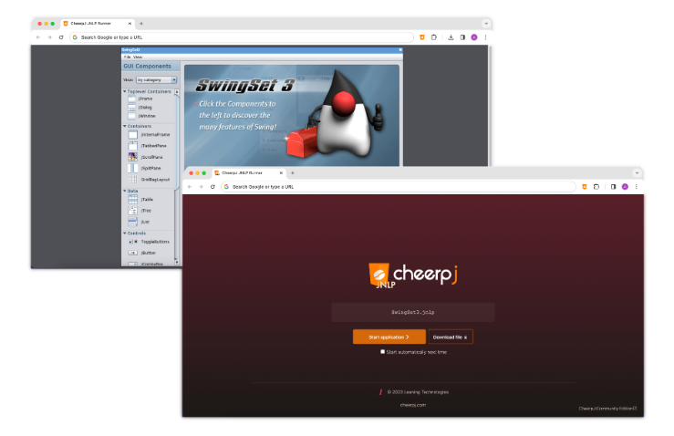

  
  

<h3 align="center">Run Java Web Start applications in the browser.</h3>

  The CheerpJ browser extension for Java Web Start, for Chrome and Edge. 
  Open a <code>.jnlp</code> file and the application runs in a tab, with no Java installed on the computer.

  <b><a href="https://chromewebstore.google.com/detail/cheerpj-jnlp-runner/achnhggjjhnadfapkmgallnbmemdojdi">Add to Chrome</a></b> ·
  <b><a href="https://microsoftedge.microsoft.com/addons/detail/cheerpj-jnlp-runner/dpleickbpchmkpkmicanfolmianepfhe">Add to Edge</a></b> ·
  <a href="https://labs.leaningtech.com/cheerpj-jnlp-runner">Docs</a> ·
  <a href="https://discord.leaningtech.com">Discord</a> ·
  <a href="https://github.com/leaningtech/cheerpj-jnlp-runner/issues/new/choose">Report a bug</a>

The extension replaces the Java Web Start client that Oracle removed from Java 11. It has been tested on Oracle E-Business Suite, Oracle Forms and hundreds of custom Java client applications. It is listed as **CheerpJ JNLP Runner** in the Chrome Web Store and Edge Add-ons. It is built on [CheerpJ](https://cheerpj.com), a Java runtime built from OpenJDK and compiled to WebAssembly, and the CheerpJ browser extensions have more than 170,000 users together.

> [!NOTE]
> This repository is the extension's public **issue tracker**. The extension's code isn't here. For an applet inside a web page, use the [extension for applets](https://github.com/leaningtech/cheerpj-applet-runner).

## How to use it

1. Install the extension from the [Chrome Web Store](https://chromewebstore.google.com/detail/cheerpj-jnlp-runner/achnhggjjhnadfapkmgallnbmemdojdi) or [Edge Add-ons](https://microsoftedge.microsoft.com/addons/detail/cheerpj-jnlp-runner/dpleickbpchmkpkmicanfolmianepfhe).
2. Click a link to a `.jnlp` file, open one from your computer, or drag it onto the extension's popup.
3. The first time, read and accept the [licence agreement](https://cheerpj.com/cheerpj-jnlp-runner-end-user-licence-agreement/). The application then starts in a new tab.

A side panel on the left of the tab downloads the `.jnlp` file, uploads files for the application, opens the settings and manages your licence. See [using the extension for the first time](https://labs.leaningtech.com/docs/cheerpj-jnlp-runner/getting-started/using-first-time).

## What it runs

| | |
| --- | --- |
| **Java** | Java 8 Web Start applications, with Swing and AWT interfaces |
| **Applications** | Oracle E-Business Suite, Oracle Forms and custom Java clients |
| **Browsers** | Chrome, Edge and other Chromium browsers on desktop |
| **Files** | Upload files from the side panel; files the application saves arrive as browser downloads ([file handling](https://labs.leaningtech.com/docs/cheerpj-jnlp-runner/guides/file-handling)) |
| **Networking** | HTTP(S) through the browser. TCP and UDP sockets through a Tailscale network, set in the extension's settings |

For Oracle Forms and EBS across an organisation, see [Oracle Forms](https://cheerpj.com/oracle-forms/) and [Oracle EBS](https://cheerpj.com/oracle-ebs/).

## For organisations

With an Enterprise licence, desktop administrators deploy the extension to managed Chrome and Edge through Group Policy or Intune, and set the licence by policy, where it activates offline. A self-hosted version serves networks that can't reach the stores, including air-gapped ones. See [enterprise configuration](https://labs.leaningtech.com/docs/cheerpj-jnlp-runner/guides/configure-extension-for-enterprises) and [private hosting](https://labs.leaningtech.com/docs/cheerpj-jnlp-runner/guides/private-hosting-for-enterprises).

## Privacy

The applications, their files and their traffic stay between your browser and their servers, and don't pass through us. The extension does send us some information:

- **Usage and error statistics** when an application starts, to Plausible Analytics, which we host ourselves. They never include the address of the `.jnlp` file, the application's name or what you type.
- **Bug reports**, only if you choose to send one when an application fails to start. A report includes the `.jnlp` file, which can name your organisation's internal servers.
- **Licence checks**, if you activate a licence.

The details are in the [privacy policy](https://cheerpj.com/privacy-policy-for-cheerpj-jnlp-runner-chrome-extension/).

## Reporting a bug

When an application fails to start, the extension offers to send us a report. You can also use **Report a bug** in the extension, or [open an issue](https://github.com/leaningtech/cheerpj-jnlp-runner/issues/new/choose). Include:

- the address of the `.jnlp` file, if it's public;
- the extension's version, from `chrome://extensions` or `edge://extensions`;
- your browser and OS;
- the full console output, from the browser's developer tools.

Issues are public. For an internal or private application, write to jnlprunner@leaningtech.com instead. Questions are welcome on [Discord](https://discord.leaningtech.com).

## Licensing

Free for personal use and technical evaluation. Business use needs a [Desktop licence](https://cheerpj.com/licensing/#run), bought online for up to 20 desktops. For larger deployments, Enterprise licences need no licence server: [contact us](https://cheerpj.com/contact/). See [the extension's licences](https://cheerpj.com/cheerpj-jnlp-runner-licenses/).

---

  <a href="https://cheerpj.com/extensions/">cheerpj.com</a> ·
  <a href="https://discord.leaningtech.com">Discord</a> ·
  <a href="https://x.com/leaningtech">X</a> ·
  Made by <a href="https://leaningtech.com">Leaning Technologies</a>

